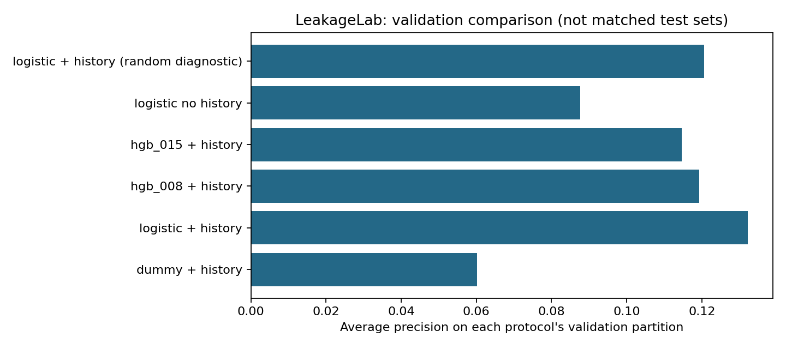
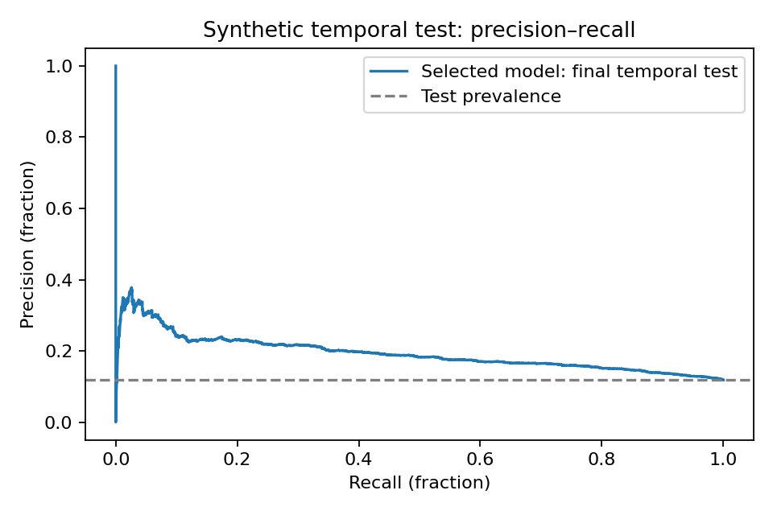

# LeakageLab — Temporal Risk Benchmark

[](https://www.kaggle.com/code/vanh1803/leakagelab-public-reference-solver)

An independent, **AI-assisted portfolio project** by Nguyen Viet Anh.

How do transaction history and delayed labels affect a model evaluated on future data?
LeakageLab turns that question into a reproducible prediction task: 50,000 synthetic
transactions, a seven-day label delay, time-based partitions, a reference solver,
and a submission grader.

[Public solver notebook](notebooks/leakagelab-public.ipynb) ·
[Problem statement and rubric](docs/problem-statement.md) ·
[Measured results](artifacts/kaggle/results/metrics.json)

## Run the public notebook

`notebooks/leakagelab-public.ipynb` runs locally or on Kaggle with **CPU**.
Open the [public Kaggle notebook](https://www.kaggle.com/code/vanh1803/leakagelab-public-reference-solver),
sign in, select **Copy & Edit**, then **Run All**. Keep the attached
[LeakageLab Public Solver Input](https://www.kaggle.com/datasets/vanh1803/leakagelab-public-solver-input)
dataset, choose **CPU**, and leave **Internet off**.
Locally it can read that ZIP (`LEAKAGELAB_PUBLIC_INPUT`) or fetch the same files
from GitHub. It loads only four solver modules and checksum-verified public inputs. No private dataset, token, GPU, or paid resource is needed.
Run all cells to fit the baselines and produce `submission.csv`.

The public notebook's clean **Save & Run All** completed successfully on Kaggle:
version 1, run **357340039**, **24.9 seconds**, five executed code cells and
**10,051 predictions**. Fresh validation AP was **0.132306**; logistic regression
was selected. Its input is public and works offline.

The notebook computes validation scores itself. Final-test figures are clearly
marked as the previously verified author-side evaluation, because the public
solver has no final-test labels.

## What the benchmark checks

- Features use strictly earlier transactions; outcome aggregates use mature labels only.
- Train, validation, and test follow time order. Seven-day maturity gaps remove 3,924 rows.
- Preprocessing is fit on training. Validation AP selects the model; validation F1 selects
  the threshold. Both choices are frozen before final grading.
- The solver reads only labeled train/validation, unlabeled test, and sample submission.
- The grader joins by transaction ID and rejects malformed IDs, schemas, and probabilities.

The realized partitions contain 28,054 training, 7,971 validation, and 10,051 test rows.
Repeated accounts are intentional: the main task predicts future transactions,
rather than restricting evaluation to unseen users.

## Verified results

Logistic regression ranked first on validation AP (0.132306), ahead of the dummy
baseline (0.060218) and two HistGradientBoosting settings (0.119311 and 0.114660).
Removing transaction-history features reduced logistic validation AP to 0.087658.

On the frozen future test, AP was **0.193127** and ROC-AUC **0.652482**, with
**11.82% positive outcomes across 10,051 transactions**. Validation prevalence
was 6.02%; higher test AP does not show that drift improved ranking.
The account-cluster bootstrap AP interval was [0.176580, 0.212811].

The original author experiment passed **18 tests locally and on Kaggle CPU**.
Kaggle version 2, run 357285783 completed in 52.8 seconds on 11 October 2026;
the benchmark and tests took 29.27 seconds after startup. Cross-environment
predictions differed by at most 3.89e-16 and test metrics agreed within 1e-12.





## Reproduce the author experiment locally

```bash
git clone https://github.com/VietAnh1803/LeakageLab.git
cd LeakageLab
python -m pip install -e ".[dev]"
python -m pytest -q
python -m leakagelab.run --config configs/config.yaml --output artifacts/local
```

On Windows, after installing dependencies, `.\reproduce.ps1` runs the tests and
benchmark together. Use `.\reproduce.ps1 -Smoke` for a smaller dataset.
Generated author data stays under the ignored local artifacts directory.

The original author notebook remains private on Kaggle. Its source is included
as `notebooks/leakagelab-kaggle.ipynb` for local review and reproduction; Kaggle
execution of that notebook requires its author's private source input.
Use the public solver notebook when you want to run without private access.

## Source and evidence

- `src/leakagelab/`: generator, feature preparation, solver, metrics, grader, and reporting.
- `tests/test_benchmark.py`: 18 checks covering time boundaries, reproducibility,
  future-row invariance, preprocessing isolation, solver inputs, and invalid submissions.
- `notebooks/`: public runner, standalone reference solver, and original author source.
- `public/solver-input/`: four permitted CSVs and their checksum manifest; no test labels.
- `artifacts/kaggle/results/`: recorded scores, comparisons, partition counts, and charts.
- [Public verification record](artifacts/public-verification.json),
  [data dictionary](docs/data-dictionary.md), [interview notes](docs/interview-notes.md),
  and [provenance](docs/provenance.md).

## Limits

All data is synthetic. One seed and one temporal fold do not establish performance
on real adverse events. The cluster bootstrap does not cover shared time/merchant
shocks or generator uncertainty. The random-split diagnostic uses a different
validation population and is not a valid future-deployment estimate.

The source generator can reproduce labels. Omitting a ground-truth CSV does not
create a secure private leaderboard or an anti-cheating boundary. No Kaggle medal,
commercial impact, frontier-agent evaluation, or Eris acceptance is claimed.
AI assisted implementation, tests, and documentation; scores come from executable
NumPy/sklearn code. This repository contains no CV, company data, or credentials.
